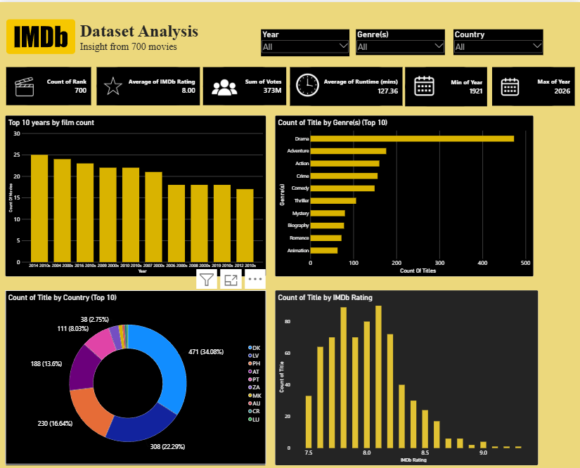
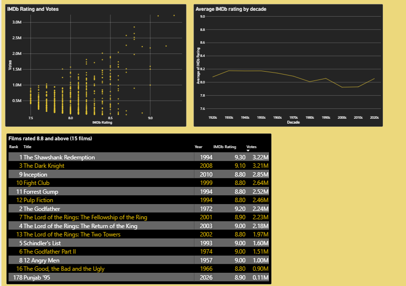

# IMDb Movie Analysis: Power BI Dashboard

An interactive Power BI dashboard analysing 700 highly rated IMDb films released between 1921 and 2026. The project covers the full workflow: cleaning and reshaping the data in Power Query, building a three-table data model, and presenting the results on a single-page dashboard.

## Key findings

- **Drama dominates.** It appears in 473 of 700 films (68%), ahead of Adventure (176), Action (160), Crime (156) and Comedy (149).
- **The 2000s and 2010s supply half the list.** 358 of 700 films (51%) come from those two decades.
- **Popularity and rating are moderately linked.** Votes and rating correlate at 0.41.
- **Average rating dips, then recovers.** It is about 8.17 in the 1930s to 1950s, falls to 7.92 in the 2000s, and rises to 8.06 in the 2020s.
- **Longer films score slightly higher.** Films over 180 minutes average 8.21, against 7.94 for films of 90 to 120 minutes.

The full write-up is in the report PDF.

## Files

| File | Description |
|---|---|
| `imdb.pbix` | Power BI Desktop project (model and dashboard) |
| `imdb_dataset.csv` | Source data: 700 films, 10 columns |
| `IMDb_Power_BI_Report.pdf` | Full project report |
| `Dashboard_Top.png` | Screenshot of the dashboard (top part) |
| `Dashboard_bottom.png` | Screenshot of the dashboard (bottom part) |

## Dashboard contents

- Slicers for year, genre and country code
- KPI cards: film count, average rating, total votes, average runtime, earliest and latest year
- Top 10 years by film count
- Top 10 genres (individual genres, not combinations)
- Country codes as supplied in the source file
- Rating distribution
- Votes versus rating scatter plot
- Average rating by decade
- Table of the 15 films rated 8.8 and above

## Data model

Three tables linked on `Rank` (one-to-many):

- `imdb dataset`: one row per film (700 rows), plus a `Decade` column added in Power Query
- `Genres`: one row per film-genre pair (1,823 rows, 22 genres)
- `country`: one row per film-country pair (1,400 rows, 19 codes)

`Genres` and `country` were built as reference queries that split pipe-delimited values into rows, so the main table stays at 700 rows and counts are not inflated.

## Opening the project

1. Install [Power BI Desktop](https://powerbi.microsoft.com/desktop/) (Windows).
2. Open `imdb.pbix`.
3. The data source points to a local path on the author's machine. To refresh, go to **Transform data > Data source settings > Change Source** and select your copy of `imdb_dataset.csv`.

## Limitations

- **Selection bias.** Only films rated 7.5 or higher are included, so findings do not generalise to all films.
- **Country field.** The country codes in the source file do not match real production countries. The country chart and slicer show the codes as supplied, and no conclusions are drawn from them.
- **Small early samples.** The 1920s (5 films) and 1930s (8 films) are too small to support firm conclusions.
- **No financial or critic data.** Success is measured only by user ratings and votes.

## Data source

## Data source

[IMDb Top 700 Movies (2026 edition) on Kaggle](https://www.kaggle.com/datasets/saitejabandaruin/imdb-top-700-movies-2026-edition/data). 
Check the dataset page for its licence before reusing the data.

## Tools

Microsoft Power BI Desktop, Power Query (M), data modelling

## Author

Abbas N, B.E. Computer Science and Engineering, Aalim Muhammed Salegh College of Engineering, 
[LinkedIn](https://www.linkedin.com/in/n-abbas-8aa9a1276)
